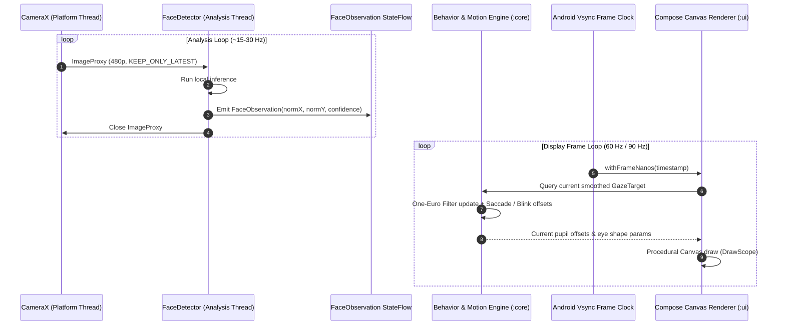

# 🧱 Architecture & System Design — EyeKage

## 1. Architectural Strategy: "Portable Core, Platform Shell"

To fulfill the cross-platform roadmap without premature cross-platform tooling overhead, EyeKage enforces a strict structural separation between **pure domain logic** and **Android platform services**.

```
                ┌────────────────────────────────────────────────────────┐
                │                     :app Module                        │
                │        Activity, Navigation, AppContainer (DI)         │
                └──────────────────────────┬─────────────────────────────┘
                                           │
                    ┌──────────────────────┴──────────────────────┐
                    ▼                                             ▼
       ┌────────────────────────┐                    ┌────────────────────────┐
       │    :feature Module     │                    │    :platform Module    │
       │ Screens, ViewModels,   │                    │ CameraX, MediaPipe/    │
       │ UDF StateFlows         │                    │ MLKit, Haptics, Data-  │
       └───────────┬────────────┘                    │ Store Prefs            │
                   │                                 └───────────┬────────────┘
                   ▼                                             │
       ┌────────────────────────┐                                │
       │       :ui Module       │                                │
       │ Compose Canvas, Theme, │                                │
       │ Tokens, Preview Mocks  │                                │
       └───────────┬────────────┘                                │
                   │                                             │
                   ▼                                             ▼
       ┌──────────────────────────────────────────────────────────────────────┐
       │                            :core Module                              │
       │                   PURE KOTLIN (No Android Imports!)                  │
       │    Domain Models, Motion Math (One-Euro), Behavior State Machine,    │
       │              Mode Registry, Hardware / Storage Ports                 │
       └──────────────────────────────────────────────────────────────────────┘
```

---

## 2. Five-Module Responsibilities & Boundary Enforcement

| Module | Plugin | Allowed Dependencies | Prohibited Dependencies | Responsibilities |
|---|---|---|---|---|
| `:core` | `kotlin("jvm")` | Kotlin stdlib, Coroutines | **ANY** Android SDK, CameraX, Compose, View, Context | Domain models (`FaceObservation`, `GazeTarget`, `EyeModeSpec`), Ports (`PreferencesRepository`, `FaceObservationSource`), One-Euro smoothing filter, behavior state machines. |
| `:ui` | `com.android.library` | `:core`, Jetpack Compose BOM, Material 3, AndroidX Graphics | `:platform`, `:feature`, CameraX, ML Kit | Procedural Compose `Canvas` eye renderer, eye shapes, gradient brushes, AGSL shaders (API 33+), dark theme tokens, preview mocks. |
| `:platform` | `com.android.library` | `:core`, CameraX (`camera-camera2`, `camera-lifecycle`), MediaPipe/MLKit, DataStore | Presentation UI composables, ViewModels | CameraX `ImageAnalysis` pipeline, on-device face detector implementation, permission-free haptics (`View.performHapticFeedback`), DataStore preferences. |
| `:feature` | `com.android.library` | `:core`, `:ui`, Compose BOM, Lifecycle ViewModel Compose | CameraX, ML Kit, direct sensor APIs | Screen composables, ViewModels exposing `StateFlow<UiState>`, handling user events (`UiEvent`), coordinating camera activation with behavior. |
| `:app` | `com.android.application` | `:core`, `:ui`, `:platform`, `:feature`, Navigation Compose | None | Composition root (`AppContainer`), `MainActivity`, Navigation graph, Android Manifest declarations. |

---

## 3. Real-Time Data Flow & Threading Model

A critical requirement is that camera latency or frame drops must **never stall the eye animation**:



### Invariant Rules:
1. **Latest Frame Only:** CameraX uses `ImageAnalysis.STRATEGY_KEEP_ONLY_LATEST`. The pipeline drops old frames immediately if inference takes longer than expected.
2. **Normalized Coordinates Only:** Only numerical bounds `[-1.0, 1.0]` leave the `:platform` module. No image buffers cross module boundaries.
3. **Continuous Animation:** When `FaceObservation` is absent, the behavior state machine automatically transitions to `Searching` → `Idle`, driving natural saccadic movements and blinking indefinitely.

---

## 4. Mode Registry & Rebrand Separation

Eye modes are defined data-first in `:core:modes`:

```kotlin
data class EyeModeSpec(
    val id: EyeModeId,             // e.g. EyeModeId("mode.crimson_tracker")
    val labelResourceKey: String,   // Key pointing to localized string
    val primaryColorArgb: Long,
    val secondaryColorArgb: Long,
    val pupilShape: PupilShapeType,
    val irisDetails: List<IrisDetailSpec>
)
```

Display names live exclusively in `:ui/src/main/res/values/mode_labels.xml`:
- In prototype builds, `mode_label_crimson_tracker` displays `"Sharingan"`.
- In commercial / neutral validation builds, a Gradle resource overlay swaps the string to `"Crimson Tracker"`.
- Codebase identifiers, classes, and tests **never** reference third-party anime trademarks.

---

## 5. Security & Privacy Architecture

1. **Manifest Gating:**
   - The only hardware permission declared is `android.permission.CAMERA`.
   - Automated Gradle task `checkMergedManifestPermissions` verifies every build flavor and fails if unapproved permissions appear.
2. **Camera Invisibility:**
   - The camera preview is never rendered on-screen. CameraX runs headless `ImageAnalysis` exclusively.
   - A dedicated in-app UI indicator illuminates whenever the camera pipeline is actively receiving frames.
3. **Zero Persistence of Biometrics:**
   - No filesystem, SQLite, or DataStore APIs exist in `:platform:vision`.
   - Instrumented tests scan app data directories after active sessions to guarantee zero leaked images.

