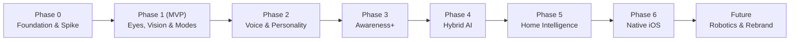
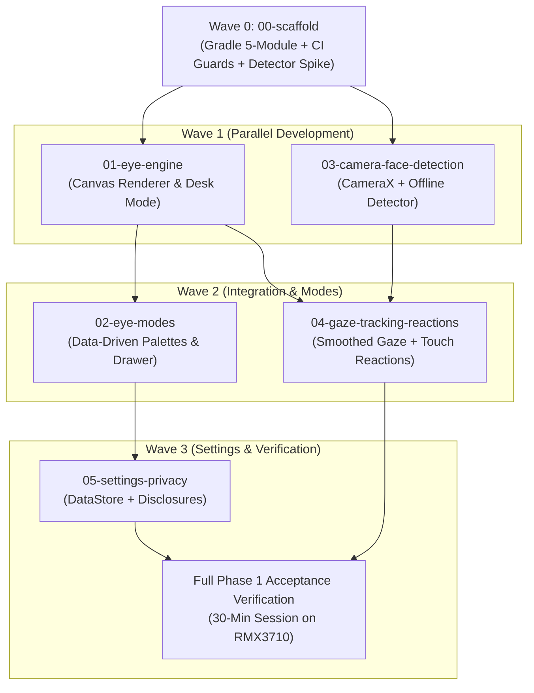
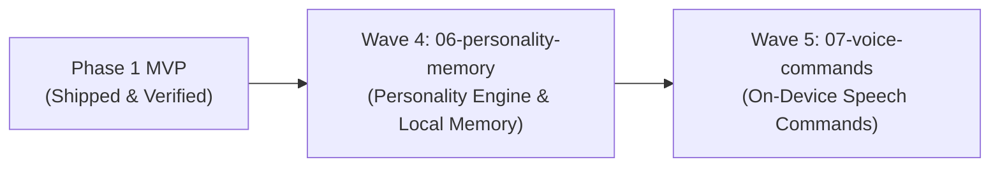

# 🗺️ Phased Roadmap & Wave Matrix — EyeKage

## 1. Product Lifecycle Roadmap

| Phase | Theme | Goals & Major Milestones |
|---|---|---|
| **Phase 0** | **Foundation & Detector Spike** | 5-module Gradle setup, CI privacy checks, test harness, **MediaPipe vs. ML Kit comparison spike** on RMX3710, `minSdk` validation. |
| **Phase 1** | **Android Companion MVP** | Procedural Canvas eye renderer, 4 data-driven modes + Awakening overlay, front-camera gaze tracking, touch reactions, settings/privacy. |
| **Phase 2** | **Voice & Personality Engine** | On-device voice commands ("EyeKage, Sharingan!"), rule-based personality, inspectable/resettable local memory, transparent adaptation. |
| **Phase 3** | **Awareness+ (Advanced Vision)** | Head pose/posture, hand gestures, presence/approach detection, multi-person counting, non-medical fatigue & blink/yawn signals. |
| **Phase 4** | **Hybrid AI Companion** | Provider-agnostic LLM interface, voice conversations, tools & actions, cloud reasoning (user-approved network access). |
| **Phase 5** | **Home Intelligence Gateway** | Separate Home AI Gateway (mini PC/NAS) integrating CCTV/RTSP, Frigate, Home Assistant, MQTT. EyeKage receives structured events. |
| **Phase 6** | **Native iOS Port** | Swift, SwiftUI, AVFoundation, Apple Vision. Reassess Kotlin Multiplatform for shared core logic. |
| **Future** | **Commercial Release** | Original commercial branding review, physical desk robot hardware integration, Play Store publication & privacy policy. |

---

## 2. Phase 1 Feature Specs Registry & Dependency Matrix

| Wave | Feature Slug | Spec Bundle Path | Primary Output | Depends On | Touches (Isolation Zone) | Status |
|---|---|---|---|---|---|---|
| **0** | `00-scaffold` | [`docs/specs/00-scaffold/`](../specs/00-scaffold/tasks.md) | 5-module project, CI privacy guards, detector comparison spike | None | Root, build-logic, all modules | ✅ `[x]` Complete |
| **1** | `01-eye-engine` | [`docs/specs/01-eye-engine/`](../specs/01-eye-engine/requirements.md) | Procedural Canvas eyes, saccades, blinks, time-based frame clock, desk mode | `00-scaffold` | `:core:motion`, `:ui:eyes` | ✅ `[x]` Complete |
| **1** | `03-camera-face-detection` | [`docs/specs/03-camera-face-detection/`](../specs/03-camera-face-detection/requirements.md) | CameraX ImageAnalysis pipeline, winning detector engine, privacy indicator | `00-scaffold` | `:platform:vision`, `:core:model` | ✅ `[x]` Complete |
| **2** | `02-eye-modes` | [`docs/specs/02-eye-modes/`](../specs/02-eye-modes/requirements.md) | Data-driven mode registry, neutral IDs, swappable string resources, mode drawer UI | `01-eye-engine` | `:core:model`, `:ui`, `:feature:companion` | ✅ `[x]` Complete |
| **2** | `04-gaze-tracking-reactions` | [`docs/specs/04-gaze-tracking-reactions/`](../specs/04-gaze-tracking-reactions/requirements.md) | Face-to-gaze mapping, One-Euro smoothing, Awakening reaction, touch poke haptics | `01-eye-engine`, `03-camera` | `:core:behavior`, `:feature:companion` | ✅ `[x]` Complete |
| **3** | `05-settings-privacy` | [`docs/specs/05-settings-privacy/`](../specs/05-settings-privacy/requirements.md) | DataStore preferences (5 keys), camera toggle, reduced motion, storage disclosures | `02-eye-modes` | `:platform:data`, `:feature:settings` | ✅ `[x]` Complete |

---

## 3. Phase 1 Dependency & Wave Graph

---

## 4. Phase 2 Feature Specs Registry & Dependency Matrix

| Wave | Feature Slug | Spec Bundle Path | Primary Output | Depends On | Touches (Isolation Zone) | Status |
|---|---|---|---|---|---|---|
| **4** | `06-personality-memory` | [`docs/specs/06-personality-memory/`](../specs/06-personality-memory/requirements.md) | Rule-based personality engine, micro-expressions, local memory DataStore, reset card | `05-settings-privacy` | `:core:behavior`, `:core:model`, `:core:ports`, `:platform:preferences`, `:ui:eyes`, `:feature:settings` | ✅ `[x]` Complete |
| **5** | `07-voice-commands` | [`docs/specs/07-voice-commands/`](../specs/07-voice-commands/requirements.md) | On-device keyword spotting, voice-triggered eye modes, audio privacy indicator | `06-personality-memory` | `:platform:audio`, `:core:ports`, `:feature:companion` | ✅ `[x]` Complete |

---

## 5. Phase 2 Dependency & Wave Graph

