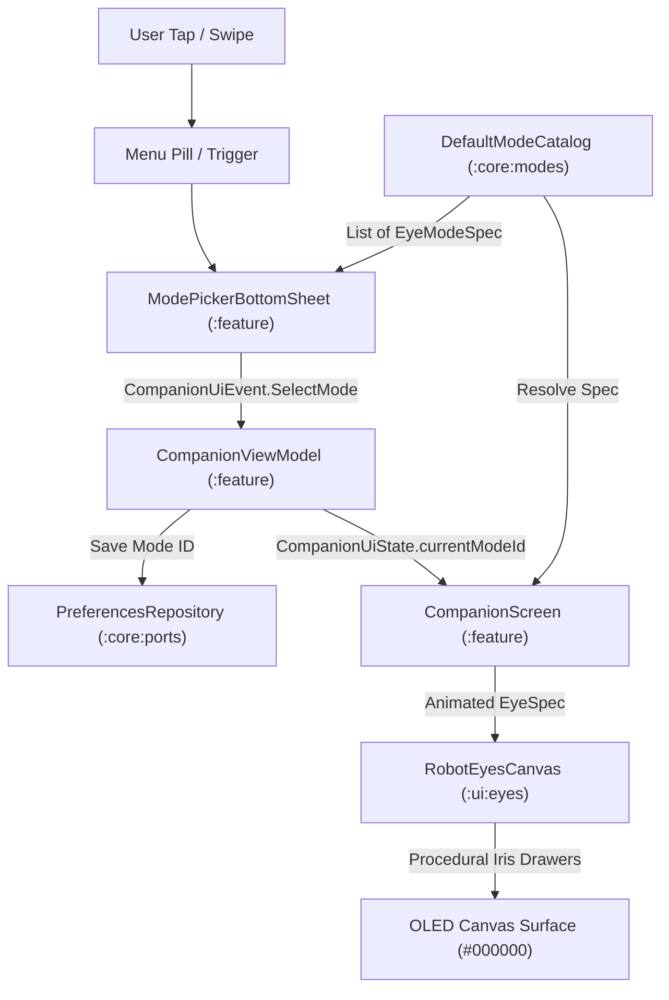

# 📐 Technical Design: Data-Driven Eye Modes (`02-eye-modes`)

> **Feature Slug:** `02-eye-modes` · **Requirements:** [`requirements.md`](./requirements.md)  
> **Visual Reference:** [`./design-reference/stitch-prompt.md`](./design-reference/stitch-prompt.md) (`docs/foundation/design-system.md`)  
> **Blast Radius:** `🟢 ISOLATED` (Pure-Kotlin mode catalog + UI iris geometry + Bottom sheet mode picker)

---

## 1. Architecture & Data Flow

The Data-Driven Eye Modes feature decouples mode definitions, procedural rendering, and user-facing labels across three clean architectural layers:

1. **Pure-Kotlin Domain Core (`:core:model`, `:core:modes`):**
   - Strictly platform-free models (`EyeModeId`, `PupilShape`, `EyeModeSpec`).
   - `DefaultModeCatalog` serves as the single source of truth for mode configurations (colors as ARGB `Long`, pupil shapes, geometry parameters).
   - Enforces rebrand safety: zero anime trademark terms in code; all mode IDs use neutral naming schemes (`mode.normal`, `mode.crimson_tracker`, `mode.white_scan`, `mode.purple_orbit`, `reaction.awakening`).
2. **Procedural Mode Geometry & Canvas (`:ui:eyes`):**
   - Extensions to `EyeSpec` and `RobotEyesCanvas` supporting mode-specific iris shapes and accents (circular crimson with tracking accents, pale lavender with scan lines, concentric violet orbital rings).
   - Smooth 200 ms color morphing between active eye mode specs.
   - Resource-backed display names via `res/values/mode_labels.xml`.
3. **Interactive Mode Switcher (`:feature:companion`):**
   - `ModePickerBottomSheet`: A dark glassmorphic bottom sheet presenting selectable mode chips with glowing visual indicators.
   - Interaction trigger: Tap on menu pill or faceplate gesture opens the sheet.
   - Dispatches `CompanionUiEvent.SelectMode(modeId)` to `CompanionViewModel`, which persists the selection to `PreferencesRepository`.



---

## 2. File Placement, Component Interfaces & Visual Mapping

| Action | Exact File Path | Layer | Responsibility & Visual Reference | Validates |
| :--- | :--- | :--- | :--- | :--- |
| `[NEW]` | `core/src/main/kotlin/com/eyekage/core/model/EyeMode.kt` | `[BE]` Core | Domain models: `EyeModeId`, `PupilShape`, and `EyeModeSpec` | `Req 1.1` |
| `[NEW]` | `core/src/main/kotlin/com/eyekage/core/modes/ModeCatalog.kt` | `[BE]` Core | `ModeCatalog` interface and `DefaultModeCatalog` registry | `Req 1.1, 2.1–2.4` |
| `[NEW]` | `core/src/test/kotlin/com/eyekage/core/modes/ModeCatalogTest.kt` | `[BE]` Test | Unit tests for catalog lookup, color validity, and trademark-free audit | `Req 1.1, 1.2` |
| `[MODIFY]` | `ui/src/main/kotlin/com/eyekage/ui/eyes/EyeSpec.kt` | `[FE]` UI | Mode mapping helper converting pure-Kotlin `EyeModeSpec` to Compose `EyeSpec` | `Req 2.1–2.4` |
| `[MODIFY]` | `ui/src/main/kotlin/com/eyekage/ui/eyes/RobotEyesCanvas.kt` | `[FE]` UI | Iris accent drawers for crimson tracker, white scan-line, purple orbit | `Req 2.1–2.4` |
| `[NEW]` | `ui/src/test/kotlin/com/eyekage/ui/eyes/ModeRenderingTest.kt` | `[FE]` Test | Unit & geometry validation for all mode drawers | `Req 2.1–2.4` |
| `[NEW]` | `feature/src/main/kotlin/com/eyekage/feature/companion/ModePickerBottomSheet.kt` | `[FE]` UI | Bottom sheet with glowing mode chips matching `stitch-prompt.md` | `Req 3.1, 3.2` |
| `[MODIFY]` | `feature/src/main/kotlin/com/eyekage/feature/companion/CompanionScreen.kt` | `[FE]` UI | Connects `RobotEyesCanvas`, menu pill trigger, and `ModePickerBottomSheet` | `Req 3.1, 3.2` |
| `[MODIFY]` | `feature/src/main/kotlin/com/eyekage/feature/companion/CompanionViewModel.kt` | `[FE]` UI | Persists mode changes via `PreferencesRepository` | `Req 3.2` |
| `[MODIFY]` | `feature/src/test/kotlin/com/eyekage/feature/companion/CompanionViewModelTest.kt` | `[FE]` Test | Verifies mode selection and persistence flow | `Req 3.2` |

---

## 3. Data Models & Contracts (`:core:model`, `:core:modes`)

### Pure-Kotlin Domain Models
```kotlin
package com.eyekage.core.model

@JvmInline
value class EyeModeId(val value: String) {
    companion object {
        val NORMAL = EyeModeId("mode.normal")
        val CRIMSON_TRACKER = EyeModeId("mode.crimson_tracker")
        val WHITE_SCAN = EyeModeId("mode.white_scan")
        val PURPLE_ORBIT = EyeModeId("mode.purple_orbit")
        val AWAKENING = EyeModeId("reaction.awakening")
    }
}

enum class PupilShape {
    ROUNDED_PILL,
    GEOMETRIC_TRACKER,
    SCAN_LINE,
    CONCENTRIC_ORBIT,
    BURST_RADIAL
}

data class EyeModeSpec(
    val id: EyeModeId,
    val labelKey: String,
    val primaryColorArgb: Long,
    val secondaryColorArgb: Long,
    val coreColorArgb: Long,
    val glowColorArgb: Long,
    val shape: PupilShape,
    val glowRadiusMultiplier: Float = 1.35f,
    val isSelectable: Boolean = true
)
```

### Color Specification Matrix (Pure JVM `Long` ARGB)
- `mode.normal`: Primary `0xFF22D3EEL`, Secondary `0xFF0891B2L`, Core `0xFFA5F3FCL`, Glow `0x6622D3EEL`
- `mode.crimson_tracker`: Primary `0xFFDC2626L`, Secondary `0xFF18181BL`, Core `0xFFFCA5A5L`, Glow `0x66DC2626L`
- `mode.white_scan`: Primary `0xFFE0E7FFL`, Secondary `0xFF818CF8L`, Core `0xFFFFFFFFL`, Glow `0x55818CF8L`
- `mode.purple_orbit`: Primary `0xFFA855F7L`, Secondary `0xFF581C87L`, Core `0xFFF3E8FFL`, Glow `0x66A855F7L`
- `reaction.awakening`: Primary `0xFFF59E0BL`, Secondary `0xFFFEF3C7L`, Core `0xFFFFFFFFL`, Glow `0x88F59E0BL`

---

## 4. UI Rendering Details & Accents

1. **`mode.normal` (Cyan Round Rect):**
   - Symmetrical rounded pill eyes with soft outer radial glow and alive reflection dot.
2. **`mode.crimson_tracker` (Crimson Iris + Geometric Accents):**
   - High-contrast crimson iris circle/pill.
   - 3 dark geometric tracking accents (tomoe-inspired or geometric accent dots) positioned at 120-degree intervals around the inner pupil.
3. **`mode.white_scan` (Pale Lavender + Scan Line):**
   - Pale lavender-white iris with soft indigo outer ring.
   - Sweeping horizontal scan line across the pupil simulating radar sweep.
4. **`mode.purple_orbit` (Violet Concentric Rings):**
   - Deep violet background with concentric circular orbital lines (2–3 rings) drawn within the iris bounds.
5. **Color Morph Animation:**
   - 200 ms `animateColorAsState` with `FastOutSlowInEasing` for primary, secondary, and glow colors.
