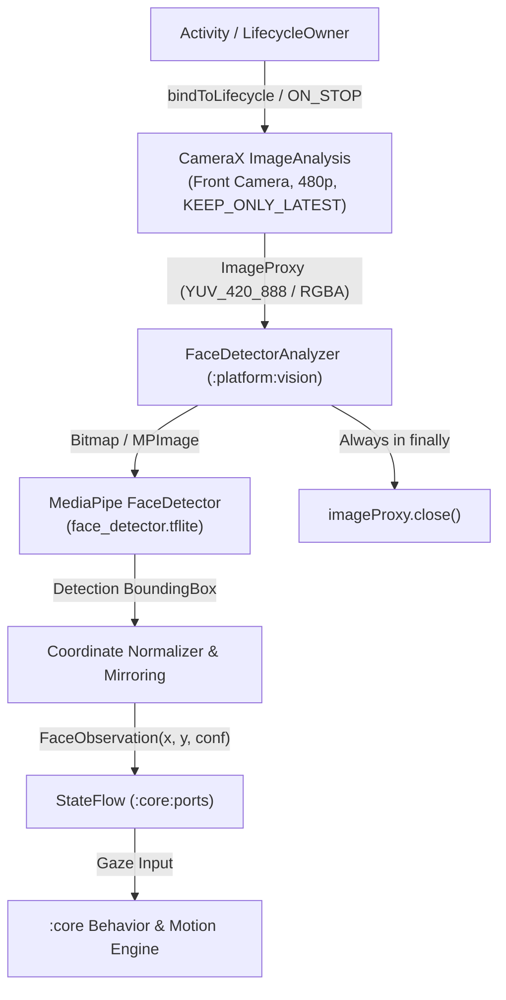

# 📐 Technical Design: On-Device Vision Pipeline (`03-camera-face-detection`)

> **Feature Slug:** `03-camera-face-detection` · **Requirements:** [`requirements.md`](./requirements.md)  
> **Visual Reference:** [`./design-reference/stitch-prompt.md`](./design-reference/stitch-prompt.md)  
> **Blast Radius:** `🟢 ISOLATED` (Scoped to `:platform:vision`, `:core:model`, `:core:ports`)

---

## 1. Architecture & Real-Time Data Flow

The on-device vision pipeline captures low-resolution video frames from the device's front-facing camera, detects face bounding boxes using MediaPipe Tasks Vision, and emits normalized $(x, y)$ coordinates without ever rendering a camera preview or writing images to storage.



### Key Architectural Invariants
1. **Headless & Display Isolation:** CameraX binds only `ImageAnalysis` (no `Preview` use case). Camera frames are never displayed on screen.
2. **Buffer Starvation Prevention:** `imageProxy.close()` is executed in a mandatory `try-finally` block for every single frame. CameraX uses `STRATEGY_KEEP_ONLY_LATEST` so slow inference cycles drop stale frames rather than buffering.
3. **Pure-Kotlin Core Boundary:** No `android.*`, `androidx.camera.*`, or MediaPipe types cross into `:core`. `:core` receives only the immutable pure Kotlin data class `FaceObservation`.
4. **Zero Persistence:** No frame bytes, bitmaps, or face embeddings are ever written to disk or database.

---

## 2. File Placement & Layer Boundaries

| Action | Exact File Path | Layer | Responsibility | Validates |
| :--- | :--- | :--- | :--- | :--- |
| `[NEW]` | `core/src/main/kotlin/com/eyekage/core/ports/FakeFaceObservationSource.kt` | `:core:ports` | Test double emitting scriptable `FaceObservation` values for unit/integration tests | `Req 3.1` |
| `[NEW]` | `core/src/main/kotlin/com/eyekage/core/model/FaceObservationTransform.kt` | `:core:model` | Pure math utilities for coordinate normalization, mirroring, and rotation transforms | `Req 3.1, 3.2` |
| `[MODIFY]` | `core/src/test/kotlin/com/eyekage/core/model/FaceObservationTest.kt` | `:core:test` | Unit tests for coordinate normalization, bounding bounds, and transform logic | `Req 3.1, 3.2` |
| `[NEW]` | `platform/src/main/kotlin/com/eyekage/platform/vision/CameraXManager.kt` | `:platform:vision` | CameraX lifecycle controller: binds front camera with `ImageAnalysis` and lifecycle observer | `Req 1.1, 1.2, 1.3` |
| `[MODIFY]` | `platform/src/main/kotlin/com/eyekage/platform/vision/VisionFaceObservationSource.kt` | `:platform:vision` | Integrates `CameraXManager` with MediaPipe face detector to implement `FaceObservationSource` | `Req 1.1, 1.2, 1.3, 3.1, 3.2` |
| `[NEW]` | `platform/src/test/kotlin/com/eyekage/platform/vision/FaceObservationTransformTest.kt` | `:platform:test` | Unit test verifying MediaPipe bounding box to normalized coordinate mapping | `Req 3.1, 3.2` |

---

## 3. Data Models & Interface Contracts

### 3.1 Core Model: `FaceObservation`
```kotlin
package com.eyekage.core.model

data class FaceObservation(
    val normalizedX: Float, // [-1.0, 1.0]: 0.0 = center, -1.0 = left, 1.0 = right
    val normalizedY: Float, // [-1.0, 1.0]: 0.0 = center, -1.0 = top, 1.0 = bottom
    val confidence: Float,  // [0.0, 1.0]
    val timestampNanos: Long = System.nanoTime()
) {
    companion object {
        val Empty = FaceObservation(0f, 0f, 0f, 0L)
    }
}
```

### 3.2 Port Contract: `FaceObservationSource`
```kotlin
package com.eyekage.core.ports

import com.eyekage.core.model.FaceObservation
import kotlinx.coroutines.flow.StateFlow

interface FaceObservationSource {
    val observations: StateFlow<FaceObservation>
    val isRunning: StateFlow<Boolean>
    fun start()
    fun stop()
}
```

### 3.3 Test Double: `FakeFaceObservationSource`
```kotlin
package com.eyekage.core.ports

class FakeFaceObservationSource(
    initialObservation: FaceObservation = FaceObservation.Empty
) : FaceObservationSource {
    private val _observations = MutableStateFlow(initialObservation)
    override val observations: StateFlow<FaceObservation> = _observations.asStateFlow()

    private val _isRunning = MutableStateFlow(false)
    override val isRunning: StateFlow<Boolean> = _isRunning.asStateFlow()

    fun emit(observation: FaceObservation) { _observations.value = observation }
    override fun start() { _isRunning.value = true }
    override fun stop() { _isRunning.value = false }
}
```

---

## 4. Error Handling & Edge Cases

| Condition | Cause | System Behavior | Validates |
|---|---|---|---|
| Camera permission denied | User rejected runtime camera permission dialog | CameraX unbinds, `isRunning = false`, indicator inactive (`#475569`), eye falls back to idle saccades | `Req 2.3` |
| App minimized / backgrounded | Lifecycle transitions to `ON_STOP` or `ON_PAUSE` | Camera unbinds automatically via `ProcessCameraProvider.unbindAll()`, releasing hardware sensor | `Req 1.2` |
| Device lacks front camera | Hardware limitation | Fallback to default camera or safe no-op with warning log, no crash | `Req 1.1` |
| MediaPipe init failure | Missing asset or incompatible GPU delegate | Falls back to CPU or emits Empty observations gracefully | `Req 3.1` |
| Frame analysis backlog | High inference time on lower-end devices | `STRATEGY_KEEP_ONLY_LATEST` discards old frames; latest frame processed immediately | `Req 1.1, 1.3` |

---

## 5. Correctness Properties & Verification Strategy

### Correctness Properties (Invariants)
- **Property 1 (Normalized Coordinate Range):** For any detection, normalized $(x, y) \in [-1.0, 1.0]$ and confidence $\in [0.0, 1.0]$.
- **Property 2 (Mirroring Consistency):** For front camera, coordinates are mirrored horizontally such that when the user moves physically to their left, the normalized $x$ coordinate moves towards $-1.0$.
- **Property 3 (Buffer Cleanup Guarantee):** Every `ImageProxy` provided to `ImageAnalysis.Analyzer` is closed in a `finally` block regardless of inference success or failure.
- **Property 4 (Lifecycle Safety):** Camera pipeline unbinds when `stop()` is invoked or lifecycle stops.
- **Property 5 (Zero Persistence):** No image bytes are saved to `filesDir`, `cacheDir`, or any persistent store.

### Verification Commands
```bash
# Core unit tests
./gradlew :core:test

# Platform unit tests
./gradlew :platform:testDebugUnitTest

# Full project compile
./gradlew compileDebugKotlin

# Manifest permission guard
./gradlew checkMergedManifestPermissions
```
