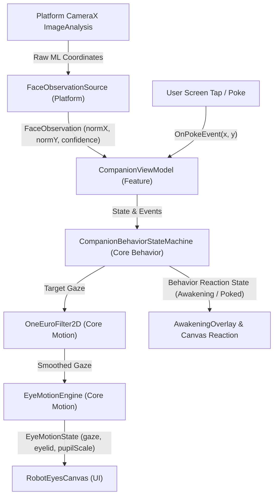

# 📐 Technical Design: Gaze Tracking & Reactions (`04-gaze-tracking-reactions`)

> **Feature Slug:** `04-gaze-tracking-reactions` · **Requirements:** [`requirements.md`](./requirements.md)  
> **Visual Reference:** [`./design-reference/`](./design-reference/) (`stitch-prompt.md`) & [`docs/foundation/design-system.md`](../../foundation/design-system.md)  
> **Blast Radius:** `🟢 ISOLATED` (Confined to `:core:behavior`, `:core:motion`, `:ui:eyes`, `:feature:companion`)

---

## 1. Architecture & Data Flow

This feature bridges normalized face detections from `FaceObservationSource` into real-time expressive robot reactions and smoothed gaze tracking.



### State Machine Lifecycle
1. **`Idle`**: Ambient state when no face is detected. Natural micro-saccades and spontaneous blinks drive pupil offsets.
2. **`Awakening`**: Triggered immediately when `FaceObservation.isFaceDetected` becomes `true` from an idle or searching state. Lasts exactly 800 ms. Displays radial amber burst (`#F59E0B`), widens pupils (`pupilScale = 1.25f`), and prepares to lock gaze onto the detected face.
3. **`Tracking`**: Entered after `Awakening` completes or while a face remains continuously detected. Coordinates are filtered through `OneEuroFilter2D` ($f_{c\text{min}} = 1.0\text{ Hz}$, $\beta = 0.007$) with mirroring compensation.
4. **`Searching`**: Triggered when a tracked face is lost. Performs searching saccades for 2.0 seconds (2000 ms) scanning left and right before returning to `Idle`.
5. **`Poked`**: Triggered immediately by user touch on the eyes area, whether camera is on or off. Induces an instantaneous startled squint/blink (`eyelidOpenness` squints to 0.1f..0.2f) for 400 ms, accompanied by permission-free haptic feedback (`performHapticFeedback`), then smoothly returns to the underlying behavior state.

---

## 2. File Placement, Component Interfaces & Visual Mapping

> Strictly follows `docs/foundation/architecture.md` and `.agents/rules/stack-rules.md` layer boundaries. Zero Android imports in `:core`.

| Action | Exact File Path | Layer | Responsibility & Visual Reference (`design-reference/`) | Validates |
| :--- | :--- | :--- | :--- | :--- |
| `[NEW]` | `core/src/main/kotlin/com/eyekage/core/behavior/CompanionState.kt` | `[BE]` Core | Domain models for behavior states (`Idle`, `Awakening`, `Tracking`, `Searching`, `Poked`) and outputs | `Req 2.1, 2.2, 3.1` |
| `[NEW]` | `core/src/main/kotlin/com/eyekage/core/behavior/CompanionBehaviorStateMachine.kt` | `[BE]` Core | Pure-Kotlin reactive state machine managing timeouts, transitions, and gaze target routing | `Req 2.1, 2.2, 3.1, 3.3` |
| `[NEW]` | `core/src/test/kotlin/com/eyekage/core/behavior/CompanionBehaviorStateMachineTest.kt` | `[BE]` Test | Pure-Kotlin unit tests for state transitions, timeouts, and touch interruption | `Req 1.2, 2.1, 2.2, 3.1` |
| `[NEW]` | `ui/src/main/kotlin/com/eyekage/ui/eyes/AwakeningOverlay.kt` | `[FE]` UI | Luminous radial amber bloom (`#F59E0B`, `#FEF3C7`) overlay rendering during `Awakening` state | `Req 2.1` |
| `[MODIFY]` | `ui/src/main/kotlin/com/eyekage/ui/eyes/RobotEyesCanvas.kt` | `[FE]` UI | Support touch/poke detection gestures and squinching eyelid/pupil modifiers | `Req 3.1, 3.2` |
| `[MODIFY]` | `feature/src/main/kotlin/com/eyekage/feature/companion/CompanionViewModel.kt` | `[FE]` Feature | Integrate behavior state machine, smoothing filter, and poke events into UDF `CompanionUiState` | `Req 1.1, 2.1, 2.2, 3.1, 3.3` |
| `[MODIFY]` | `feature/src/main/kotlin/com/eyekage/feature/companion/CompanionScreen.kt` | `[FE]` Feature | Mount `AwakeningOverlay`, wire haptic feedback via `View.performHapticFeedback`, handle poke gestures | `Req 2.1, 3.1, 3.2, 3.3` |
| `[NEW]` | `feature/src/main/kotlin/com/eyekage/feature/companion/DebugFaceOverlay.kt` | `[FE]` Feature | Debug overlay rendering normalized bounding boxes and coordinates as shapes in debug mode | `Req 1.1` |
| `[MODIFY]` | `feature/src/test/kotlin/com/eyekage/feature/companion/CompanionViewModelTest.kt` | `[FE]` Test | ViewModel unit tests verifying behavior reactions, camera toggle, and poke event dispatching | `Req 1.1, 2.1, 2.2, 3.1` |

---

## 3. Data Models & State Contracts

### Pure-Kotlin Behavior Domain Models (`com.eyekage.core.behavior`)

```kotlin
sealed interface CompanionState {
    data object Idle : CompanionState
    data class Awakening(val elapsedMs: Long, val totalDurationMs: Long = AWAKENING_DURATION_MS) : CompanionState
    data object Tracking : CompanionState
    data class Searching(val elapsedMs: Long, val totalDurationMs: Long = SEARCHING_DURATION_MS) : CompanionState
    data class Poked(val elapsedMs: Long, val totalDurationMs: Long = POKED_DURATION_MS, val previousState: CompanionState) : CompanionState

    companion object {
        const val AWAKENING_DURATION_MS = 800L
        const val SEARCHING_DURATION_MS = 2000L
        const val POKED_DURATION_MS = 400L
    }
}

data class BehaviorOutput(
    val state: CompanionState,
    val targetGaze: GazeTarget,
    val eyelidScale: Float = 1.0f,
    val pupilScale: Float = 1.0f,
    val awakeningProgress: Float = 0.0f
)
```

---

## 4. Error & Edge Case Handling Matrix

| Scenario / Edge Case | Condition | System Behavior | Validates |
| :--- | :--- | :--- | :--- |
| **Camera Disabled** | `isCameraEnabled == false` | State machine stays in `Idle`, but touch / poke reactions continue to operate with 100% responsiveness and haptics | `Req 3.3` |
| **Rapid Face Flapping** | Face appears and disappears in < 100 ms | Awakening completes smoothly or transitions to Searching without erratic visual snaps | `Req 2.1, 2.2` |
| **Screen Poke during Awakening** | User taps eyes while Awakening burst is playing | Squint reaction interrupts/blends into Poked state, then transitions to Tracking | `Req 3.1` |
| **Out-of-Bounds Coordinates** | ML Kit emits abnormal coordinates | `GazeTarget` strictly clamps to `[-1.0f, 1.0f]` range | `Req 1.1` |
| **Zero Haptic Permission** | System has no `VIBRATE` permission | Uses `View.performHapticFeedback(HapticFeedbackConstants.CONTEXT_CLICK)` safely without crash | `Req 3.2` |

---

## 5. Correctness Properties & Verification Strategy

### Correctness Properties (Invariants)
- **Property 1 (Awakening Determinism):** Whenever a face is detected from `Idle` or `Searching`, the state MUST be `Awakening` for exactly 800 ms before entering `Tracking`.
- **Property 2 (Gaze Smoothing Latency):** Filtered gaze targets must smooth high-frequency micro-jitter at stationary gaze ($f_c = 1.0\text{ Hz}$) while responding to step inputs with latency $\le 150\text{ ms}$.
- **Property 3 (Touch Autonomy):** Poking the screen triggers `Poked` reaction and haptics regardless of whether the camera is running or stopped.
- **Property 4 (Searching Fallback):** When a tracked face is lost, the state MUST transition to `Searching` for 2000 ms before returning to `Idle`.

### Verification Commands
- **Kotlin Compile & Typecheck:** `.\gradlew compileDebugKotlin`
- **Unit Tests:** `.\gradlew testDebugUnitTest`
- **Pure-Kotlin Invariant Check:** Verify `:core` contains 0 Android imports.
