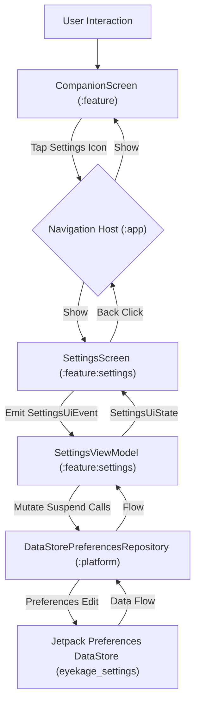

# 📐 Technical Design: Settings & Privacy Disclosures (`05-settings-privacy`)

> **Feature Slug:** `05-settings-privacy` · **Requirements:** [`requirements.md`](./requirements.md)  
> **Visual Reference:** [`./design-reference/stitch-prompt.md`](./design-reference/stitch-prompt.md) (`docs/foundation/design-system.md`)  
> **Blast Radius:** `🟢 ISOLATED` (DataStore persistence layer + Settings screen + Companion navigation wiring)

---

## 1. Architecture & Data Flow

The Settings & Privacy Disclosures feature delivers local user preferences persistence and full transparency disclosures across three decoupled architectural layers:

1. **Pure-Kotlin Domain Core (`:core:ports`):**
   - `PreferencesRepository` defines asynchronous Flow-based ports and suspend mutating functions for the strictly approved 5 Phase 1 preference keys:
     - `default_mode_id`: String (`"mode.normal"`)
     - `camera_enabled`: Boolean (`false`)
     - `reduced_motion_override`: String (`"SYSTEM"` | `"ON"` | `"OFF"`)
     - `haptics_enabled`: Boolean (`true`)
     - `desk_mode_enabled`: Boolean (`false`)
   - Absolutely zero Android SDK dependencies in `:core`.

2. **Platform Persistence Shell (`:platform:preferences`):**
   - `DataStorePreferencesRepository` implements `PreferencesRepository` using Jetpack Preferences DataStore (`eyekage_settings`).
   - Supports dependency injection of `DataStore<Preferences>` to enable deterministic, fast JVM unit testing via `PreferenceDataStoreFactory`.
   - Zero additional or unapproved keys may ever be written to disk.

3. **Settings Presentation & Transparency UI (`:feature:settings`, `:feature:companion`, `:app`):**
   - `SettingsViewModel` exposes a reactive `StateFlow<SettingsUiState>` through Unidirectional Data Flow (UDF) combining the 5 preference streams from `PreferencesRepository`.
   - `SettingsScreen` displays:
     - Material 3 `TopAppBar` with back button to Companion faceplate.
     - "Companion Preferences" card with Switches for Desk Mode, Camera Vision, and Haptic Feedback.
     - SingleChoiceSegmentedButtonRow (or segmented chip row) for Reduced Motion (`SYSTEM`, `ON`, `OFF`).
     - Default Eye Mode Dropdown selector mapped to available selectable modes from `ModeCatalog`.
     - `DataPrivacyDisclosureCard`: An elevated dark card with green privacy shield icon detailing local-only processing, zero internet, and exact storage footprint.
   - Navigation: Back arrow navigates to `CompanionScreen`; `CompanionScreen` provides a settings icon in the top-start corner to open `SettingsScreen`.



---

## 2. File Placement, Component Interfaces & Visual Mapping

| Action | Exact File Path | Layer | Responsibility & Visual Reference | Validates |
| :--- | :--- | :--- | :--- | :--- |
| `[MODIFY]` | `platform/src/main/kotlin/com/eyekage/platform/preferences/DataStorePreferencesRepository.kt` | `[BE]` Platform | Add constructor for injected `DataStore<Preferences>` to allow JVM testing | `Req 1.1, 1.2` |
| `[NEW]` | `platform/src/test/kotlin/com/eyekage/platform/preferences/DataStorePreferencesRepositoryTest.kt` | `[BE]` Test | Fast JVM unit tests for default fallbacks and roundtrip async writes | `Req 1.1, 1.2` |
| `[NEW]` | `feature/src/main/kotlin/com/eyekage/feature/settings/SettingsUiState.kt` | `[FE]` Feature | Immutable state & event models for Settings UI | `Req 2.1–2.3` |
| `[NEW]` | `feature/src/main/kotlin/com/eyekage/feature/settings/SettingsViewModel.kt` | `[FE]` Feature | ViewModel managing preference updates and UI state flow | `Req 2.1–2.3` |
| `[NEW]` | `feature/src/main/kotlin/com/eyekage/feature/settings/DataPrivacyDisclosureCard.kt` | `[FE]` Feature | Dedicated disclosure card matching `stitch-prompt.md` | `Req 3.1, 3.2` |
| `[NEW]` | `feature/src/main/kotlin/com/eyekage/feature/settings/SettingsScreen.kt` | `[FE]` Feature | Settings screen composable with switches, segmented buttons, dropdown | `Req 2.1–2.3, 3.1, 3.2` |
| `[NEW]` | `feature/src/test/kotlin/com/eyekage/feature/settings/SettingsViewModelTest.kt` | `[FE]` Test | Unit tests for SettingsViewModel event handling and repository binding | `Req 2.1–2.3` |
| `[MODIFY]` | `feature/src/main/kotlin/com/eyekage/feature/companion/CompanionScreen.kt` | `[FE]` Feature | Add settings button (top-start) and `onNavigateToSettings` callback | `Req 2.1` |
| `[MODIFY]` | `app/src/main/kotlin/com/eyekage/MainActivity.kt` | `[FE]` App | Wire navigation between `CompanionScreen` and `SettingsScreen` | `Req 2.1` |

---

## 3. Data Models & Contracts (`:feature:settings`)

### Settings UI State & Events
```kotlin
package com.eyekage.feature.settings

import com.eyekage.core.modes.ModeCatalog

data class SettingsUiState(
    val defaultModeId: String = "mode.normal",
    val isCameraEnabled: Boolean = false,
    val reducedMotionOverride: String = "SYSTEM", // "SYSTEM", "ON", "OFF"
    val isHapticsEnabled: Boolean = true,
    val isDeskModeEnabled: Boolean = false,
    val availableModes: List<com.eyekage.core.model.EyeModeSpec> = emptyList(),
    val isLoading: Boolean = false
)

sealed interface SettingsUiEvent {
    data class SetDefaultMode(val modeId: String) : SettingsUiEvent
    data class SetCameraEnabled(val enabled: Boolean) : SettingsUiEvent
    data class SetReducedMotion(val option: String) : SettingsUiEvent
    data class SetHapticsEnabled(val enabled: Boolean) : SettingsUiEvent
    data class SetDeskModeEnabled(val enabled: Boolean) : SettingsUiEvent
}
```

---

## 4. Error Handling & Correctness Properties

1. **Property 1 — Strict 5-Key Allowlist:**
   Under no circumstances will keys outside `default_mode_id`, `camera_enabled`, `reduced_motion_override`, `haptics_enabled`, and `desk_mode_enabled` be defined or written in `DataStorePreferencesRepository`.
2. **Property 2 — Safe Default Fallbacks:**
   When DataStore is freshly initialized (empty), reads immediately emit defined default values without blocking:
   - `default_mode_id` = `"mode.normal"`
   - `camera_enabled` = `false`
   - `reduced_motion_override` = `"SYSTEM"`
   - `haptics_enabled` = `true`
   - `desk_mode_enabled` = `false`
3. **Property 3 — Zero Telemetry & Biometric Persistence:**
   No camera frames, face observation coordinates, or logs are ever persisted to DataStore, SharedPreferences, or filesystem.
4. **Property 4 — Unidirectional State Consistency:**
   Every user toggle dispatches a discrete `SettingsUiEvent`, immediately updating persistent storage in coroutine scope, which automatically flows back into `SettingsUiState` via DataStore Flow emissions.
