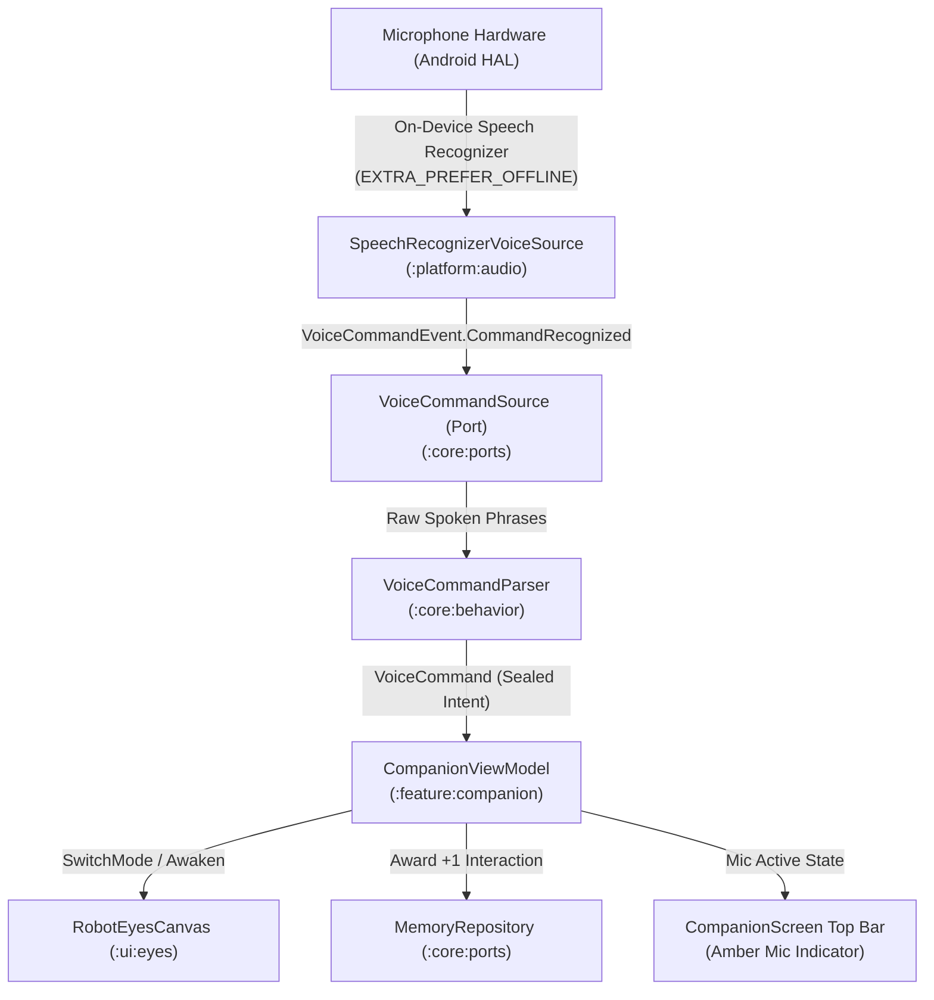

# 📐 Technical Design: On-Device Voice Commands (`07-voice-commands`)

> **Feature Slug:** `07-voice-commands` · **Requirements:** [`requirements.md`](./requirements.md)  
> **Visual Reference:** [`./design-reference/stitch-prompt.md`](./design-reference/stitch-prompt.md)  
> **Blast Radius:** `🟡 CONTAINED` (Touches `:platform:audio`, `:core:ports`, `:core:behavior`, `:feature:companion`, `:feature:settings`, `:app`)

---

## 1. Architecture & Data Flow

Voice commands enter the app through the device microphone via the Android `SpeechRecognizer` in `:platform:audio`. The platform implementation emits raw phrase tokens to a pure-Kotlin `VoiceCommandSource` port. The `VoiceCommandParser` in `:core:behavior` evaluates the tokens against registered command synonyms and emits strongly-typed `VoiceCommand` events to `CompanionViewModel` in `:feature:companion`.



---

## 2. File Placement, Component Interfaces & Visual Mapping

| Action | Exact File Path | Layer | Responsibility & Visual Reference | Validates |
| :--- | :--- | :--- | :--- | :--- |
| `[NEW]` | `core/src/main/kotlin/com/eyekage/core/model/VoiceCommand.kt` | `[BE]` Model | Sealed class representing voice commands and event models | `Req 1.1` |
| `[NEW]` | `core/src/main/kotlin/com/eyekage/core/model/VoiceCommandEvent.kt` | `[BE]` Model | Sealed class representing speech pipeline lifecycle events | `Req 1.1, 1.3` |
| `[NEW]` | `core/src/main/kotlin/com/eyekage/core/ports/VoiceCommandSource.kt` | `[BE]` Port | Interface for stream of voice command events and controls | `Req 1.3` |
| `[NEW]` | `core/src/main/kotlin/com/eyekage/core/ports/FakeVoiceCommandSource.kt` | `[BE]` Test | Test double emitting test voice commands for unit tests | `Req 1.3` |
| `[NEW]` | `core/src/main/kotlin/com/eyekage/core/behavior/VoiceCommandParser.kt` | `[BE]` Behavior | Pure-Kotlin token matching and synonym resolution | `Req 1.2, 1.4` |
| `[NEW]` | `core/src/test/kotlin/com/eyekage/core/behavior/VoiceCommandParserTest.kt` | `[BE]` Test | Unit tests for phrase matching, synonyms, and noise rejection | `Req 1.2, 1.4` |
| `[MODIFY]`| `core/src/main/kotlin/com/eyekage/core/ports/PreferencesRepository.kt` | `[BE]` Port | Adds `voiceCommandsEnabled: Flow<Boolean>` and setter | `Req 4.1` |
| `[MODIFY]`| `platform/src/main/kotlin/com/eyekage/platform/preferences/DataStorePreferencesRepository.kt` | `[BE]` Platform | Persists `voice_commands_enabled` in DataStore | `Req 4.1` |
| `[NEW]` | `platform/src/main/kotlin/com/eyekage/platform/audio/SpeechRecognizerVoiceSource.kt` | `[BE]` Platform | Android `SpeechRecognizer` offline implementation | `Req 2.1–2.5` |
| `[NEW]` | `platform/src/test/kotlin/com/eyekage/platform/audio/SpeechRecognizerVoiceSourceTest.kt` | `[BE]` Test | Unit/Robolectric tests for permission and lifecycle handling | `Req 2.1–2.5` |
| `[MODIFY]`| `app/src/main/AndroidManifest.xml` | `[BE]` Manifest | Declares `RECORD_AUDIO` permission | `Req 5.1` |
| `[MODIFY]`| `build.gradle.kts` | `[BE]` Build Logic | Updates `checkMergedManifestPermissions` allowlist task | `Req 5.2, 5.3` |
| `[MODIFY]`| `app/src/main/kotlin/com/eyekage/di/AppContainer.kt` | `[BE]` DI | Provides `VoiceCommandSource` singleton in composition root | `Req 2.1` |
| `[MODIFY]`| `feature/src/main/kotlin/com/eyekage/feature/companion/CompanionViewModel.kt` | `[FE]` ViewModel | Listens to `VoiceCommandSource`, dispatches modes, records memory | `Req 3.2, 3.3, 3.4` |
| `[MODIFY]`| `feature/src/main/kotlin/com/eyekage/feature/companion/CompanionScreen.kt` | `[FE]` Screen | Amber microphone privacy indicator and permission handling | `Req 3.1` |
| `[NEW]` | `feature/src/test/kotlin/com/eyekage/feature/companion/CompanionViewModelVoiceTest.kt` | `[FE]` Test | Unit tests verifying voice commands trigger mode & awaken | `Req 3.2, 3.3` |
| `[NEW]` | `feature/src/main/kotlin/com/eyekage/feature/settings/VoiceCommandsCard.kt` | `[FE]` UI Component | Voice commands toggle card, phrase chips, privacy badge | `Req 4.2, 4.3, 4.4` |
| `[MODIFY]`| `feature/src/main/kotlin/com/eyekage/feature/settings/SettingsScreen.kt` | `[FE]` Screen | Mounts `VoiceCommandsCard` directly in Settings | `Req 4.2` |
| `[MODIFY]`| `feature/src/main/kotlin/com/eyekage/feature/settings/SettingsViewModel.kt` | `[FE]` ViewModel | Exposes `voiceCommandsEnabled` state and toggle handler | `Req 4.1` |
| `[NEW]` | `feature/src/test/kotlin/com/eyekage/feature/settings/VoiceCommandsCardTest.kt` | `[FE]` Test | Unit test for settings toggle and state reflection | `Req 4.1, 4.2` |

---

## 3. Data Models & Contracts

### Domain Models (`:core:model`)

```kotlin
sealed interface VoiceCommand {
    data class SwitchMode(val mode: EyeMode) : VoiceCommand
    data object TriggerAwakening : VoiceCommand
    data object Sleep : VoiceCommand
    data object Blink : VoiceCommand
    data object CenterGaze : VoiceCommand
}

sealed interface VoiceCommandEvent {
    data object ListeningStarted : VoiceCommandEvent
    data class CommandRecognized(val command: VoiceCommand, val rawPhrase: String) : VoiceCommandEvent
    data object ListeningStopped : VoiceCommandEvent
    data class Error(val message: String, val isPermissionError: Boolean = false) : VoiceCommandEvent
}
```

### Port Interface (`:core:ports`)

```kotlin
interface VoiceCommandSource {
    val events: Flow<VoiceCommandEvent>
    val isListening: StateFlow<Boolean>
    fun startListening()
    fun stopListening()
}
```

### Command Phrase Mapping Matrix

| Neutral Command ID | Spoken Keyword / Phrases (Case-Insensitive) | Action Executed |
| :--- | :--- | :--- |
| `command.mode.normal` | `"normal"`, `"normal eyes"`, `"default"`, `"reset mode"` | Sets eye mode to `EyeMode.Normal` |
| `command.mode.crimson` | `"crimson"`, `"crimson tracker"`, `"red eyes"`, `"sharingan"` | Sets eye mode to `EyeMode.CrimsonTracker` |
| `command.mode.white_scan`| `"white"`, `"white scan"`, `"scan"`, `"byakugan"` | Sets eye mode to `EyeMode.WhiteScan` |
| `command.mode.purple_orbit`| `"purple"`, `"purple orbit"`, `"orbit"`, `"rinnegan"` | Sets eye mode to `EyeMode.PurpleOrbit` |
| `command.awaken` | `"awaken"`, `"wake up"`, `"eyekage awaken"`, `"hello eyekage"` | Triggers Awakening reaction + mood boost |
| `command.sleep` | `"sleep"`, `"rest"`, `"go to sleep"`, `"goodnight"` | Transitions companion into resting drowsy state |
| `command.blink` | `"blink"`, `"wink"` | Triggers single procedural eyelid blink |
| `command.center` | `"center"`, `"look forward"`, `"look at me"` | Centers pupil gaze |

---

## 4. Error Handling Matrix

| Scenario / Failure | Originating Layer | Handling Strategy | User Feedback |
| :--- | :--- | :--- | :--- |
| `RECORD_AUDIO` permission denied | `:platform:audio` | Emits `VoiceCommandEvent.Error(isPermissionError = true)`. Reverts preference toggle to `false`. | Inline permission rationale banner in Settings / Companion Screen. |
| SpeechRecognizer service unavailable | `:platform:audio` | Emits `VoiceCommandEvent.Error`. Stops listening gracefully. | Mic indicator turns off; message in Settings card. |
| Noise / unrecognized background chatter | `:core:behavior` | `VoiceCommandParser` returns `null`. Event ignored. | No disruptive toasts; eyes remain in current state. |
| App paused / backgrounded (`ON_STOP`) | `:feature:companion` | ViewModel immediately calls `stopListening()`. Hardware released. | Amber mic indicator turns off instantly. |

---

## 5. Correctness Properties

- **Property 1 (Valid Command Execution & Progression):** Any recognized spoken phrase matching the synonym catalog MUST emit the exact corresponding `VoiceCommand`, update `CompanionViewModel`'s state within 100ms, and increment companion memory interactions by $+1$.
- **Property 2 (Zero Cloud & Zero Storage Invariant):** At NO POINT shall any audio buffer be serialized to disk, cache, or preferences. Merged manifest MUST contain only `android.permission.CAMERA` and `android.permission.RECORD_AUDIO`, and MUST fail the build if `INTERNET` is present.
