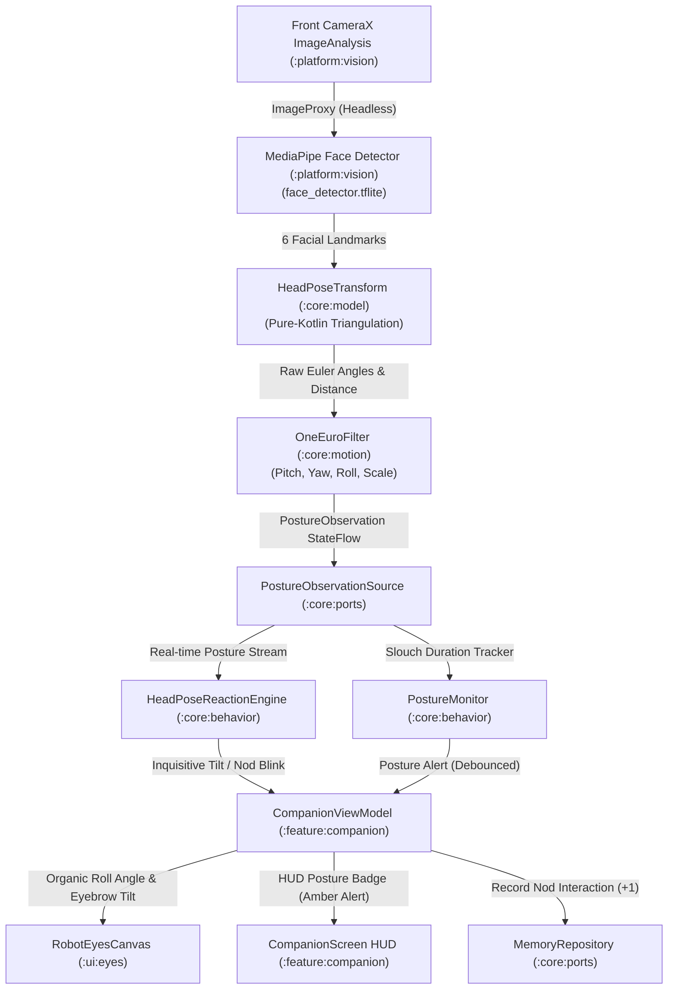

# 📐 Technical Design: Head Pose & Desk Posture Awareness (`08-head-pose-posture`)

> **Feature Slug:** `08-head-pose-posture` · **Requirements:** [`requirements.md`](./requirements.md)  
> **Visual Reference:** [`./design-reference/stitch-prompt.md`](./design-reference/stitch-prompt.md)  
> **Blast Radius:** `🟡 CONTAINED` (Touches `:platform:vision`, `:core:model`, `:core:behavior`, `:core:ports`, `:ui:eyes`, `:feature:companion`, `:feature:settings`, `:app`)

---

## 1. Architecture & Data Flow

Head pose and posture observations originate from on-device front camera frames analyzed by MediaPipe Tasks Vision Face Detector in `:platform:vision`. The detector extracts the 6 standard facial landmarks (eyes, nose, mouth, ears) and passes them to the pure-Kotlin `HeadPoseTransform` in `:core:model`. Euler angles (Pitch, Yaw, Roll) and spatial proximity are filtered through a `OneEuroFilter` for smooth, jitter-free streaming.

The `HeadPoseReactionEngine` in `:core:behavior` evaluates these streams to trigger inquisitive eye tilts, affirmative nod acknowledgements, and posture alert cues. The `CompanionViewModel` in `:feature:companion` orchestrates these behaviors and renders them through `RobotEyesCanvas` in `:ui:eyes` and `CompanionScreen` HUD.



---

## 2. File Placement, Component Interfaces & Visual Mapping

| Action | Exact File Path | Layer | Responsibility & Visual Reference | Validates |
| :--- | :--- | :--- | :--- | :--- |
| `[NEW]` | `core/src/main/kotlin/com/eyekage/core/model/HeadPose.kt` | `[BE]` Model | Encapsulates Euler angles: `pitchDegrees`, `yawDegrees`, `rollDegrees` | `Req 1.1` |
| `[NEW]` | `core/src/main/kotlin/com/eyekage/core/model/PostureObservation.kt` | `[BE]` Model | Combines `HeadPose`, `ProximityZone`, `PostureState`, and distance ratio | `Req 1.3` |
| `[NEW]` | `core/src/main/kotlin/com/eyekage/core/model/HeadPoseTransform.kt` | `[BE]` Model | Pure-Kotlin geometric calculation of Euler angles and distance from landmarks | `Req 1.2, 1.5` |
| `[NEW]` | `core/src/test/kotlin/com/eyekage/core/model/HeadPoseTransformTest.kt` | `[BE]` Test | Unit tests for tilt (roll), turn (yaw), nod (pitch), and proximity zones | `Req 1.2, 1.5` |
| `[NEW]` | `core/src/main/kotlin/com/eyekage/core/ports/PostureObservationSource.kt` | `[BE]` Port | Interface exposing `val posture: StateFlow<PostureObservation>` and tracking state | `Req 1.4` |
| `[NEW]` | `core/src/main/kotlin/com/eyekage/core/ports/FakePostureObservationSource.kt` | `[BE]` Test | Test double emitting deterministic head pose and posture observations | `Req 1.4` |
| `[NEW]` | `core/src/main/kotlin/com/eyekage/core/behavior/HeadPoseReactionEngine.kt` | `[BE]` Behavior | Evaluates gestures: curious tilt, affirmative nod cycles, and turned-away pause | `Req 3.1, 3.2, 3.3` |
| `[NEW]` | `core/src/test/kotlin/com/eyekage/core/behavior/HeadPoseReactionEngineTest.kt` | `[BE]` Test | Unit tests for nod detection, tilt hysteresis, and gesture dispatch | `Req 3.1, 3.2, 3.3` |
| `[NEW]` | `core/src/main/kotlin/com/eyekage/core/behavior/PostureMonitor.kt` | `[BE]` Behavior | Tracks continuous slouch duration with configurable debounced alert emission | `Req 3.4, 3.5` |
| `[NEW]` | `core/src/test/kotlin/com/eyekage/core/behavior/PostureMonitorTest.kt` | `[BE]` Test | Unit tests for debounce timing, alert clearing, and threshold triggers | `Req 3.4, 3.5` |
| `[MODIFY]`| `core/src/main/kotlin/com/eyekage/core/ports/PreferencesRepository.kt` | `[BE]` Port | Adds `postureReminderEnabled` and `postureSlouchThresholdSec` flows and setters | `Req 4.1` |
| `[MODIFY]`| `platform/src/main/kotlin/com/eyekage/platform/preferences/DataStorePreferencesRepository.kt` | `[BE]` Platform | Persists `posture_reminder_enabled` and `posture_slouch_threshold_sec` | `Req 4.1` |
| `[NEW]` | `platform/src/main/kotlin/com/eyekage/platform/vision/VisionHeadPoseSource.kt` | `[BE]` Platform | MediaPipe landmark keypoints extractor + OneEuroFilter smoothing | `Req 2.1–2.5` |
| `[NEW]` | `platform/src/test/kotlin/com/eyekage/platform/vision/VisionHeadPoseSourceTest.kt` | `[BE]` Test | Unit tests for smoothing, camera lifecycle release, and empty frame fallbacks | `Req 2.1–2.5` |
| `[MODIFY]`| `app/src/main/kotlin/com/eyekage/di/AppContainer.kt` | `[BE]` DI | Provides `PostureObservationSource` singleton wiring | `Req 2.1` |
| `[MODIFY]`| `ui/src/main/kotlin/com/eyekage/ui/eyes/RobotEyesCanvas.kt` | `[FE]` UI | Adds `eyeTiltDegrees` canvas rotation and organic curious squint | `Req 3.1` |
| `[MODIFY]`| `feature/src/main/kotlin/com/eyekage/feature/companion/CompanionViewModel.kt` | `[FE]` ViewModel | Integrates `PostureObservationSource`, `HeadPoseReactionEngine`, and `PostureMonitor` | `Req 3.1–3.5` |
| `[MODIFY]`| `feature/src/main/kotlin/com/eyekage/feature/companion/CompanionScreen.kt` | `[FE]` Screen | Renders subtle amber Posture Alert Badge in HUD when slouching is detected | `Req 3.2, 3.4` |
| `[NEW]` | `feature/src/test/kotlin/com/eyekage/feature/companion/CompanionViewModelPostureTest.kt` | `[FE]` Test | Unit tests verifying head tilt reaction, nod memory increment, and posture alert | `Req 3.1–3.5` |
| `[NEW]` | `feature/src/main/kotlin/com/eyekage/feature/settings/PostureSettingsCard.kt` | `[FE]` UI Component | AMOLED dark card for posture toggle, live state badge, and sensitivity chips | `Req 4.2–4.4` |
| `[MODIFY]`| `feature/src/main/kotlin/com/eyekage/feature/settings/SettingsScreen.kt` | `[FE]` Screen | Mounts `PostureSettingsCard` directly beneath `VoiceCommandsCard` | `Req 4.2` |
| `[MODIFY]`| `feature/src/main/kotlin/com/eyekage/feature/settings/SettingsViewModel.kt` | `[FE]` ViewModel | Exposes posture preference states and toggle/chip handlers | `Req 4.1, 4.3` |
| `[NEW]` | `feature/src/test/kotlin/com/eyekage/feature/settings/PostureSettingsCardTest.kt` | `[FE]` Test | Unit tests verifying posture card interaction and DataStore persistence | `Req 4.1–4.3` |

---

## 3. Data Models & Component Contracts

### Domain Models (`:core:model`)

```kotlin
data class HeadPose(
    val pitchDegrees: Float, // Negative = looking down (slouch/nod), Positive = chin up
    val yawDegrees: Float,   // Negative = looking left, Positive = looking right
    val rollDegrees: Float,  // Negative = tilted left, Positive = tilted right
    val timestampNanos: Long = System.nanoTime()
) {
    companion object {
        val Neutral = HeadPose(0f, 0f, 0f, 0L)
    }
}

enum class ProximityZone {
    TOO_CLOSE, // < 30 cm (eyeSpan > 0.35)
    NEAR,      // 30 - 45 cm (eyeSpan 0.22 .. 0.35)
    NORMAL,    // 45 - 65 cm (eyeSpan 0.12 .. 0.22)
    FAR        // > 65 cm (eyeSpan < 0.12)
}

enum class PostureState {
    BALANCED,
    SLOUCHING_DOWN,
    LEANING_CLOSE,
    TILTED_CURIOUS,
    TURNED_AWAY
}

data class PostureObservation(
    val headPose: HeadPose,
    val proximity: ProximityZone,
    val estimatedDistanceRatio: Float,
    val postureState: PostureState,
    val timestampNanos: Long = System.nanoTime()
) {
    companion object {
        val Neutral = PostureObservation(
            headPose = HeadPose.Neutral,
            proximity = ProximityZone.NORMAL,
            estimatedDistanceRatio = 0.18f,
            postureState = PostureState.BALANCED,
            timestampNanos = 0L
        )
    }
}
```

### Port Interface (`:core:ports`)

```kotlin
interface PostureObservationSource {
    val posture: StateFlow<PostureObservation>
    val isTracking: StateFlow<Boolean>
    fun start()
    fun stop()
}
```

### Geometric Angle Calculations (`HeadPoseTransform.kt`)

1. **Roll (Head Tilt Angle):**
   $$\text{Roll} = \arctan2(y_{\text{leftEye}} - y_{\text{rightEye}}, x_{\text{leftEye}} - x_{\text{rightEye}}) \times \frac{180}{\pi}$$
   Inverted appropriately for front-camera mirroring.
2. **Yaw (Head Horizontal Turn):**
   $$\text{midX}_{\text{eyes}} = \frac{x_{\text{leftEye}} + x_{\text{rightEye}}}{2}$$
   $$\text{interOcularDist} = \max(|x_{\text{leftEye}} - x_{\text{rightEye}}|, 0.001)$$
   $$\text{yawRatio} = \frac{x_{\text{nose}} - \text{midX}_{\text{eyes}}}{\text{interOcularDist}}$$
   $$\text{yawDegrees} = (\text{yawRatio} \times 90^\circ).\text{coerceIn}(-90^\circ, 90^\circ)$$
3. **Pitch (Head Vertical Nod / Slouch):**
   $$\text{eyeLineY} = \frac{y_{\text{leftEye}} + y_{\text{rightEye}}}{2}$$
   $$\text{noseDrop} = y_{\text{nose}} - \text{eyeLineY}$$
   $$\text{mouthDrop} = y_{\text{mouth}} - y_{\text{nose}}$$
   $$\text{verticalRatio} = \frac{\text{noseDrop}}{\max(\text{noseDrop} + \text{mouthDrop}, 0.001f)}$$
   Standard baseline is $\approx 0.58f$. Looking down shifts ratio upwards:
   $$\text{pitchDegrees} = ((\text{verticalRatio} - 0.58f) \times 140^\circ).\text{coerceIn}(-90^\circ, 90^\circ)$$

---

## 4. Error Handling Matrix

| Scenario / Edge Case | Originating Layer | Handling Strategy | User Experience | Validates |
| :--- | :--- | :--- | :--- | :--- |
| Face lost or obscured | `:platform:vision` | `VisionHeadPoseSource` emits `PostureObservation.Neutral`. Filters reset smoothly. | Robot eyes gently return to neutral tilt; no abrupt visual snapping. | `Req 1.5, 2.5` |
| Sensor noise / rapid flicker | `:core:motion` | 4-channel `OneEuroFilter` ($f_{c\text{min}} = 1.0\text{ Hz}, \beta = 0.007$) damps micro-jitter. | Fluid, calm eye and posture reactions without erratic twitching. | `Req 2.2` |
| Extreme head turn ($> 60^\circ$) | `:core:behavior` | Marked as `TURNED_AWAY`. Gaze lock pauses smoothly; pupils remain centered. | Companion waits patiently without pupil strain or weird wall-eyed gaze. | `Req 3.3` |
| Slouch corrected quickly ($< 10\text{s}$) | `:core:behavior` | `PostureMonitor` resets timer before debounce threshold ($30\text{s}$). | Zero false alerts for momentary desk adjustments or picking up a pen. | `Req 3.4, 3.5` |
| Camera stopped or backgrounded | `:feature:companion` | ViewModel immediately halts analysis and releases camera pipeline. | Zero battery drain in background; indicators turn off instantly. | `Req 2.5` |

---

## 5. Correctness Properties & Verification Strategy

### Correctness Properties (Invariants)

- **Property 1 (Pose Proportionality & Determinism):** *For any* sequence of facial landmarks, `HeadPoseTransform` MUST output pitch, yaw, and roll angles strictly within $[-90.0^\circ, 90.0^\circ]$ with zero NaN/Infinite values, and positive roll MUST correspond to user head tilting right. *(Validates: `Req 1.1, 1.2, 1.5`)*
- **Property 2 (Zero Storage & Privacy Invariant):** At NO POINT shall any camera frame, bitmap, landmark array, or biometric vector be persisted to disk, cache, or database. Manifest allowlist MUST strictly enforce zero `INTERNET` permissions. *(Validates: `Req 2.4, 5.1, 5.2`)*
- **Property 3 (Debounced Posture Alert Invariant):** The system SHALL NEVER emit a posture slouch alert unless `SLOUCHING_DOWN` or `LEANING_CLOSE` is sustained continuously for $\ge$ the configured threshold, and SHALL clear immediately upon posture correction. *(Validates: `Req 3.4, 3.5, 4.1`)*

### Verification Commands

- **Kotlin Compile & Typecheck:** `./gradlew compileDebugKotlin`
- **Unit & Invariant Tests:** `./gradlew testDebugUnitTest`
- **CI Manifest Privacy Allowlist:** `./gradlew checkMergedManifestPermissions`
- **Full Architecture Verification:** `./gradlew check testDebugUnitTest`
