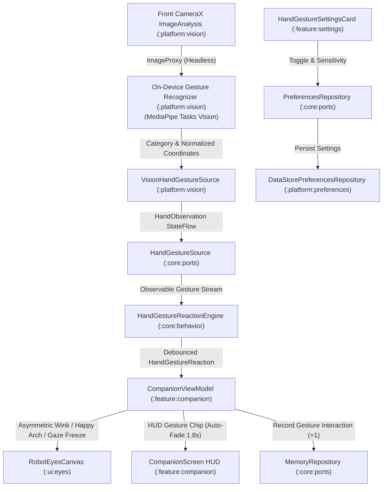

# 📐 Technical Design: Hand Gesture Recognition & Interactive Reactions (`09-hand-gestures`)

> **Feature Slug:** `09-hand-gestures` · **Requirements:** [`requirements.md`](./requirements.md)  
> **Visual Reference:** [`./design-reference/stitch-prompt.md`](./design-reference/stitch-prompt.md)  
> **Blast Radius:** `🟡 CONTAINED` (Touches `:platform:vision`, `:core:model`, `:core:behavior`, `:core:ports`, `:ui:eyes`, `:feature:companion`, `:feature:settings`, `:app`)

---

## 1. Architecture & Data Flow

Hand gesture recognition operates on front-facing camera frames provided through CameraX in `:platform:vision`. The vision pipeline detects macroscopic hand gestures (Wave, Peace, Thumbs Up, Fist, Flat Palm) using on-device inference, transforms normalized detection metrics into centered `[-1.0, 1.0]` coordinates, and emits structured `HandObservation` states through the pure-Kotlin `HandGestureSource` port.

The `HandGestureReactionEngine` in `:core:behavior` applies temporal debouncing ($150\text{--}200\text{ ms}$) and re-trigger cooldowns ($1.5\text{ seconds}$) to prevent jitter and accidental spam. When a gesture is confirmed, `CompanionViewModel` triggers tailored procedural eye responses in `RobotEyesCanvas` (playful winks, cheerful happy crescents, affirmative bounces, and focused pupil constrictions) and displays a temporary feedback chip in `CompanionScreen` HUD while logging interaction affinity in `MemoryRepository`.



---

## 2. File Placement, Component Interfaces & Visual Mapping

| Action | Exact File Path | Layer | Responsibility & Visual Reference | Validates |
| :--- | :--- | :--- | :--- | :--- |
| `[NEW]` | `core/src/main/kotlin/com/eyekage/core/model/HandGesture.kt` | `[BE]` Model | Enum of supported macroscopic hand gestures and sensitivity levels | `Req 1.1, 1.7` |
| `[NEW]` | `core/src/main/kotlin/com/eyekage/core/model/HandObservation.kt` | `[BE]` Model | Encapsulates detected gesture, confidence, bounding center, and area | `Req 1.2` |
| `[NEW]` | `core/src/main/kotlin/com/eyekage/core/model/HandGestureReaction.kt` | `[BE]` Model | Sealed hierarchy of companion behavioral eye reactions | `Req 1.3` |
| `[NEW]` | `core/src/main/kotlin/com/eyekage/core/ports/HandGestureSource.kt` | `[BE]` Port | Interface exposing `val handGestures: StateFlow<HandObservation>` and tracking state | `Req 1.4` |
| `[NEW]` | `core/src/main/kotlin/com/eyekage/core/ports/FakeHandGestureSource.kt` | `[BE]` Test | Test double emitting deterministic hand observations | `Req 1.4` |
| `[NEW]` | `core/src/main/kotlin/com/eyekage/core/behavior/HandGestureReactionEngine.kt` | `[BE]` Behavior | Evaluates gestures with temporal debounce and cooldown state machine | `Req 1.5, 1.6, 1.7` |
| `[NEW]` | `core/src/test/kotlin/com/eyekage/core/behavior/HandGestureReactionEngineTest.kt` | `[BE]` Test | Unit tests for debounce confirmation, cooldown suppression, and sensitivity | `Req 1.5, 1.6, 1.7` |
| `[MODIFY]`| `core/src/main/kotlin/com/eyekage/core/ports/PreferencesRepository.kt` | `[BE]` Port | Adds `gestureRecognitionEnabled` and `gestureSensitivity` flows and setters | `Req 4.1` |
| `[MODIFY]`| `platform/src/main/kotlin/com/eyekage/platform/preferences/DataStorePreferencesRepository.kt` | `[BE]` Platform | Persists `gesture_recognition_enabled` and `gesture_sensitivity` in DataStore | `Req 4.1` |
| `[NEW]` | `platform/src/main/kotlin/com/eyekage/platform/vision/VisionHandGestureSource.kt` | `[BE]` Platform | On-device MediaPipe gesture recognizer and frame coordinate mapper | `Req 2.1–2.5` |
| `[NEW]` | `platform/src/test/kotlin/com/eyekage/platform/vision/VisionHandGestureSourceTest.kt` | `[BE]` Test | Unit tests for coordinate normalization, lifecycle stop, and observation emission | `Req 2.1–2.5` |
| `[MODIFY]`| `app/src/main/kotlin/com/eyekage/di/AppContainer.kt` | `[BE]` DI | Provides `HandGestureSource` singleton wiring | `Req 5.1, 5.2` |
| `[MODIFY]`| `ui/src/main/kotlin/com/eyekage/ui/eyes/RobotEyesCanvas.kt` | `[FE]` UI | Supports asymmetrical left/right eye openness multipliers for winks | `Req 3.2` |
| `[MODIFY]`| `feature/src/main/kotlin/com/eyekage/feature/companion/CompanionViewModel.kt` | `[FE]` ViewModel | Connects `HandGestureSource` and `HandGestureReactionEngine` to UI state | `Req 3.1–3.6` |
| `[MODIFY]`| `feature/src/main/kotlin/com/eyekage/feature/companion/CompanionScreen.kt` | `[FE]` Screen | Renders animated emerald Active Gesture Feedback chip in HUD bar | `Req 3.4, 3.6` |
| `[NEW]` | `feature/src/test/kotlin/com/eyekage/feature/companion/CompanionViewModelGestureTest.kt` | `[FE]` Test | Unit tests verifying gesture reactions, winks, memory increments, and HUD badges | `Req 3.1–3.6` |
| `[NEW]` | `feature/src/main/kotlin/com/eyekage/feature/settings/HandGestureSettingsCard.kt` | `[FE]` UI Component | AMOLED dark card with gesture switch, live preview pill, and sensitivity chips | `Req 4.2–4.5` |
| `[MODIFY]`| `feature/src/main/kotlin/com/eyekage/feature/settings/SettingsScreen.kt` | `[FE]` Screen | Mounts `HandGestureSettingsCard` directly beneath `PostureSettingsCard` | `Req 4.2` |
| `[MODIFY]`| `feature/src/main/kotlin/com/eyekage/feature/settings/SettingsViewModel.kt` | `[FE]` ViewModel | Exposes gesture preferences and toggle/sensitivity handlers | `Req 4.1, 4.3` |
| `[NEW]` | `feature/src/test/kotlin/com/eyekage/feature/settings/HandGestureSettingsCardTest.kt` | `[FE]` Test | Unit tests verifying gesture card UI interaction and DataStore persistence | `Req 4.1–4.4` |

---

## 3. Data Models & Component Contracts

### Domain Models (`:core:model`)

```kotlin
enum class HandGesture {
    NONE,
    WAVE,
    PEACE_SIGN,
    THUMBS_UP,
    CLOSED_FIST,
    FLAT_PALM_STOP
}

enum class GestureSensitivity(
    val minConfidence: Float,
    val confirmationWindowMs: Long
) {
    LOW(minConfidence = 0.75f, confirmationWindowMs = 250L),
    NORMAL(minConfidence = 0.60f, confirmationWindowMs = 150L),
    HIGH(minConfidence = 0.50f, confirmationWindowMs = 100L)
}

data class HandObservation(
    val gesture: HandGesture,
    val confidence: Float,
    val normalizedCenterX: Float? = null,
    val normalizedCenterY: Float? = null,
    val boundingBoxArea: Float = 0f,
    val timestampNanos: Long = System.nanoTime()
) {
    val isGestureDetected: Boolean
        get() = gesture != HandGesture.NONE && confidence > 0f

    companion object {
        val Empty = HandObservation(
            gesture = HandGesture.NONE,
            confidence = 0f,
            timestampNanos = 0L
        )
    }
}

sealed interface HandGestureReaction {
    data class WaveGreeting(val timestampMs: Long) : HandGestureReaction
    data class PeaceWink(val isLeftEye: Boolean = true, val timestampMs: Long) : HandGestureReaction
    data class ThumbsUpApproval(val timestampMs: Long) : HandGestureReaction
    data class FistResolve(val timestampMs: Long) : HandGestureReaction
    data class HoldStop(val isFrozen: Boolean) : HandGestureReaction
    data object None : HandGestureReaction
}
```

### Port Contracts (`:core:ports`)

```kotlin
interface HandGestureSource {
    val handGestures: StateFlow<HandObservation>
    val isTracking: StateFlow<Boolean>
    fun start()
    fun stop()
}
```

### Preferences Contract Extensions (`:core:ports`)

```kotlin
interface PreferencesRepository {
    // Existing keys...
    val gestureRecognitionEnabled: Flow<Boolean>
    val gestureSensitivity: Flow<String>

    suspend fun setGestureRecognitionEnabled(enabled: Boolean)
    suspend fun setGestureSensitivity(sensitivity: String)
}
```

---

## 4. Error Handling Matrix

| Category | Trigger | System Response | UI Behavior | Validates |
| :--- | :--- | :--- | :--- | :--- |
| `confidence` | Detected hand gesture has confidence $< \text{threshold}$ | `HandGestureReactionEngine` ignores candidate gesture | Retains previous companion expression; no HUD badge emitted | `Req 1.7` |
| `jitter / flicker` | User rapidly flails or changes gestures within $< 150\text{ ms}$ | Confirmation window resets; requires stable continuous hold | Eyes do not jerk or flash; smooth idle/tracking animation continues | `Req 1.5` |
| `repetition` | User keeps holding same gesture continuously | Cooldown timer ($1.5\text{s}$) suppresses redundant re-triggers | Expression decays smoothly back to normal companion gaze | `Req 1.6` |
| `camera_lifecycle` | Camera stops (`ON_STOP`, app backgrounded, or camera toggled off) | `VisionHandGestureSource` releases analyzers and emits `Empty` | In-app camera indicator turns gray; gesture HUD chip dismisses | `Req 2.5` |
| `reduced_motion` | Android reduced motion / animation disabled is active | Clamps wink and bounce durations; executes static eyelid shifts | No rapid pupil oscillation or jarring bouncing | `Req 3.1, 3.3` |

---

## 5. Correctness Properties & Verification Strategy

### Correctness Properties (Invariants)
- **Property 1 (Confirmation & Cooldown Invariant):** *For any* candidate gesture stream, `HandGestureReactionEngine` SHALL emit a `HandGestureReaction` *if and only if* the candidate gesture maintains confidence $\ge \text{minConfidence}$ continuously for $\ge \text{confirmationWindowMs}$, and SHALL enforce $\ge 1500\text{ ms}$ silence before re-firing the same gesture. *(Validates: `Req 1.5, 1.6, 1.7`)*
- **Property 2 (Offline & Privacy Invariant):** *Under all execution paths*, zero raw camera frames, bitmaps, skin embeddings, or hand landmarks are written to disk, SQLite, or preferences. Merged manifests contain zero network permissions. *(Validates: `Req 2.4`)*
- **Property 3 (Independent Render Frame Clock):** Procedural eye animations and winks render at display refresh rate ($60/90\text{ Hz}$) even if camera analysis frame rate fluctuates between $10\text{--}15\text{ Hz}$ or halts. *(Validates: `Req 2.2, 3.1`)*

### Verification Commands
- **Kotlin Compile Check (Every Task):** `./gradlew compileDebugKotlin`
- **Unit Tests (Core & Feature Logic):** `./gradlew testDebugUnitTest`
- **Privacy & Manifest Allowlist Guard:** `./gradlew checkMergedManifestPermissions`
- **Full Verification Suite:** `./gradlew check testDebugUnitTest`
